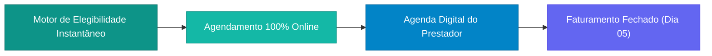
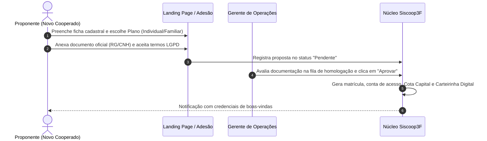
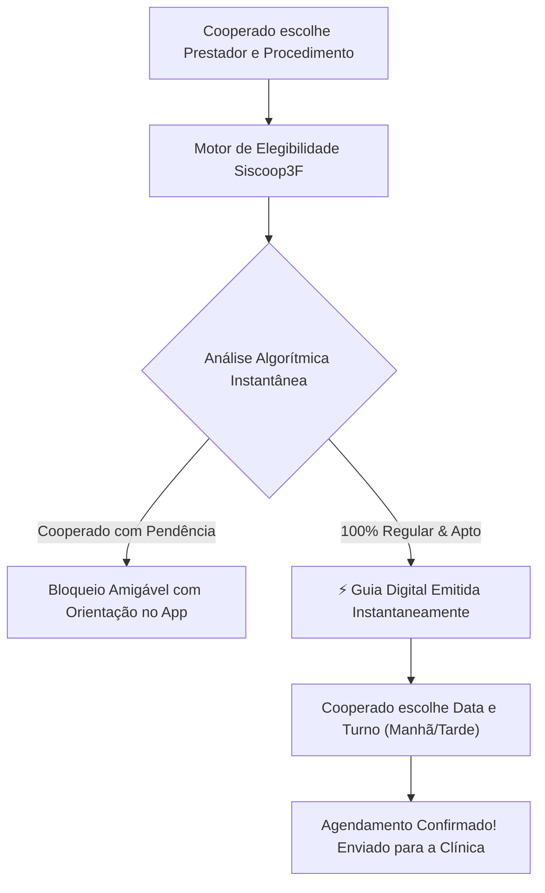

# Apresentação Executiva: Plataforma Integrada de Gestão Cooperativa de Saúde (Siscoop3F)

> **Documento Base para Geração de Slides e Demonstração Executiva**  
> **Cliente / Entidade-Alvo:** CB Saúde — Cooperativa de Saúde, Governança e Benefícios  
> **Domínio de Demonstração:** `cbsaude.siscoop3f.com.br` (Local: `cbsaude.localhost:8000`)  
> **Modelo Operacional:** 100% Online — Motor de Elegibilidade Instantânea (Zero Burocracia)

---

## Estrutura do Roteiro (Slide Deck Outline)

Este documento foi projetado para alimentar ferramentas de IA geradoras de apresentações (ex.: Gamma, Beautiful.ai, SlidesAI, Tome) ou subsidiar a condução presencial direta à Diretoria e Conselho da **CB Saúde**.

```
[Slide 1: Capa Executiva] ────────┐
                                  ▼
[Slide 2: Cenário e Desafios] ────┴──► [Slide 3: A Solução Siscoop3F]
                                                    │
                                                    ▼
[Slide 4: Mapa dos 4 Atores] ◄──────────────────────┘
      │
      ├─► [Slide 5: Fluxo 1 - Adesão e Ingresso Societário]
      ├─► [Slide 6: Fluxo 2 - Governança, Contas e Cota Capital]
      ├─► [Slide 7: Fluxo 3 - Agendamento 100% Online & Elegibilidade Instantânea]
      └─► [Slide 8: Fluxo 4 - Painel do Prestador & Regra do Dia 05]
                                                    │
                                                    ▼
[Slide 9: Painel de Indicadores] ◄──────────────────┘
      │
      ▼
[Slide 10: Roteiro Prático de Demonstração (Caminho Feliz Digital)]
      │
      ▼
[Slide 11: Conclusão e Próximos Passos]
```

---

## Slide 1: Capa Executiva

- **Título:** Modernização Digital, Mobilidade e Eficiência na Saúde Cooperativa
- **Subtítulo:** Apresentação da Plataforma Integrada de Operações e Benefícios da CB Saúde
- **Apresentador:** Equipe de Tecnologia & Projetos Estratégicos
- **Público:** Diretoria Executiva, Conselho de Administração e Conselho Fiscal
- **Mensagem-Chave:** *Uma experiência 100% digital que conecta cooperados, dependentes e prestadores médicos sem filas de balcão e sem atrasos manuais de autorização.*

---

## Slide 2: Cenário Atual e Desafios Operacionais

### O Desafio
As cooperativas de saúde tradicionais sofrem com processos físicos lentos:
1. **Atendimento de Balcão Ineficiente:** O cooperado vai presencialmente à clínica e precisa aguardar na recepção a checagem manual de CPF ou ligação para a cooperativa.
2. **Constrangimento Público:** Se o cooperado possuir qualquer pendência, o bloqueio ocorre na frente de outros pacientes no balcão da clínica.
3. **Gargalos de Autorização Humana:** Pedidos que dependem de um funcionário da cooperativa para dar "OK" ficam travados em finais de semana, feriados ou fora do horário comercial.
4. **Fechamento Mensal Caótico:** Prestadores sem previsibilidade de faturamento, gerando divergências no fechamento do mês.

---

## Slide 3: A Solução Siscoop3F para a CB Saúde

### Pilares Fundamentais



1. **Motor de Elegibilidade em Tempo Real:** O sistema analisa algorítmicamente em milissegundos se o cooperado está ativo, em dia com a Cota Capital e com documentação homologada.
2. **Autorização Digital Instantânea:** Procedimentos eletivos são pré-autorizados na hora pelo sistema, sem necessitar de atendente ou carimbo manual.
3. **Mobilidade Total (Mobile First):** O cooperado escolhe o parceiro credenciado, o serviço e a data preferencial direto pelo celular.
4. **Painel do Parceiro Focado em Atendimentos:** As clínicas recebem a lista de pacientes com guias já aprovadas e valores pré-acordados, precisando apenas confirmar a realização.

---

## Slide 4: Definição dos Atores e Papéis no Sistema

| Ator / Perfil | Descrição e Papel Estratégico | O Que Faz no Sistema |
| :--- | :--- | :--- |
| **1. Diretoria e Gestão Operacional** *(Presidente, Diretor Financeiro, Gerente)* | Liderança executiva responsável pela sustentabilidade financeira e governança da cooperativa. | Monitora os painéis em tempo real, homologa novas propostas na fila e liquida as faturas médicas consolidadas. |
| **2. Conselho Fiscal e Auditoria** *(Presidente do Conselho Fiscal, Auditor)* | Órgão independente de conformidade estatutária e integridade financeira. | Audita balancetes contábeis, livros fiscais, trilhas de conformidade LGPD e saldos de Cota Capital. |
| **3. Cooperado Titular** *(Membro Associado)* | O associado que forma o patrimônio cooperativo e utiliza a rede de benefícios. | Consulta a Carteirinha Digital, pesquisa a Rede Credenciada, solicita agendamentos online e acompanha seus dependentes. |
| **4. Dependente Familiar** *(Cônjuge, Filhos e Agregados)* | Beneficiário coberto pelo plano familiar do cooperado. | Acessa sua carteirinha individual diretamente via Link Mágico seguro pelo WhatsApp/E-mail sem senha complexa. |
| **5. Prestador Credenciado** *(Clínicas, Laboratórios e Consultórios)* | Rede médica parceira conveniada para prestar os serviços de saúde. | Visualiza a fila de agendamentos recebidos, atende com garantia de cobertura e conclui atendimentos para a fatura do Dia 05. |

---

## Slide 5: Fluxo 1 — Adesão e Ingresso Societário Digital



---

## Slide 6: Fluxo 2 — Governança Financeira e Cota Capital

1. **Gestão de Contas Bancárias Integradas:**
   - Visualização em tempo real de disponibilidades em bancos parceiros (ex.: Sicoob e Sicredi - R$ 397.150,00).
   - Movimentações segregadas entre receitas associativas, despesas administrativas e repasses médicos.
2. **Integralização Transparente da Cota Capital:**
   - Acompanhamento do patrimônio individual de cada cooperado.
   - Histórico de parcelas e segurança jurídica estatutária.

---

## Slide 7: Fluxo 3 — Agendamento 100% Online & Elegibilidade Instantânea

### A Grande Inovação Operacional
O cooperado não precisa de autorizações burocráticas demoradas. O sistema valida tudo em tempo real:



### O que o Motor Analisa Automaticamente:
- **Status do Cooperado:** Ativo e homologado.
- **Adimplência de Cota Capital:** Nenhuma parcela vencida em aberto.
- **Mensalidade:** Nenhuma pendência fora da tolerância.
- **Credenciamento do Prestador:** Parceiro ativo e procedimento contratualmente acordado.

---

## Slide 8: Fluxo 4 — Painel do Prestador & Regra do Dia 05

### O Prestador não atende no escuro:
1. **Recepção Livre de Burocracia:** O prestador não precisa buscar CPF no balcão nem telefonar para a cooperativa.
2. **Central de Atendimentos Recebidos:** A clínica abre seu painel e vê todos os pacientes já agendados com número da guia e valor acordado.
3. **Conclusão com 1 Clique:** Após a consulta, o prestador clica em "Concluir Atendimento". O procedimento vai direto para o lote de fechamento do **Dia 05**.

---

## Slide 9: Painel Executivo e Indicadores Estratégicos (KPIs)

```
┌─────────────────────────┬─────────────────────────┬─────────────────────────┐
│     QUADRO SOCIAL       │      ATENDIMENTOS       │   FINANÇAS OPERACIONAIS │
│ 5 Associados Cadastrados│ 4 Agendamentos Digitais │ Saldo Caixa Consolidado │
│ 3 Titulares Adimplentes │ 100% Guias Validadas    │ R$ 397.150,00           │
│ 2 Propostas na Fila     │ 0 Espera de Balcão      │ Faturamento em Dia      │
└─────────────────────────┴─────────────────────────┴─────────────────────────┘
```

---

## Slide 10: Roteiro Prático de Demonstração (O Caminho Feliz 100% Digital)

Seqüência prática de 15 minutos para encantar a Diretoria:

### Passo 1: O Ponto de Vista do Cooperado (Agendamento em 30 Segundos)
- **Login:** `joao.associado@gmail.com` (senha: `senha123`).
- **Ação:** Entrar em **Rede Credenciada > Clínica São Lucas**. Clicar no botão **Agendar**.
- **O que mostrar:** O Motor de Elegibilidade informando em verde: *"Elegibilidade Confirmada! Cadastro 100% regular"*. Escolher data, turno e clicar em **Confirmar**. Mostrar a guia digital emitida na hora.

### Passo 2: A Prova de Segurança (Cenário com Pendência)
- **Login:** `carlos.inadimplente@gmail.com` (senha: `senha123`).
- **Ação:** Entrar na Rede Credenciada e tentar agendar uma consulta.
- **O que mostrar:** O sistema informando de forma segura e elegante que existe uma parcela de Cota Capital pendente, impedindo a emissão indevida da guia e resguardando o caixa da cooperativa.

### Passo 3: O Ponto de Vista da Clínica Parceira
- **Login:** `sao.lucas@gmail.com` (senha: `senha123`).
- **O que mostrar:** A tela sem formulários de balcão. O agendamento que João Silva acabou de fazer já aparece na tabela com a guia autorizada. Clicar no botão **Concluir Atendimento** para demonstrar o fechamento do ciclo.

### Passo 4: Governança e Diretoria
- **Login:** `presidente@cbsaude.com.br` ou `gerente@cbsaude.com.br`.
- **O que mostrar:** O painel consolidado com o total de atendimentos realizados, saldo bancário do Sicoob e Sicredi, e a proposta da Dra. Fernanda pronta para homologação ao vivo.

---

## Slide 11: Conclusão, Segurança e Próximos Passos

- **Zero Atendimento de Balcão:** Fim das filas e constrangimentos na recepção das clínicas.
- **Autonomia Total do Cooperado:** Solicitação e agendamento pelo celular em qualquer dia ou horário.
- **Segurança Financeira:** O motor algorítmico impede qualquer atendimento de inadimplentes antes mesmo de chegar à clínica.
- **Previsibilidade Contratual:** Prestadores com faturamento transparente e pontual na Regra do Dia 05.
