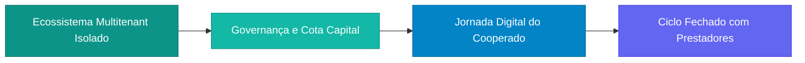
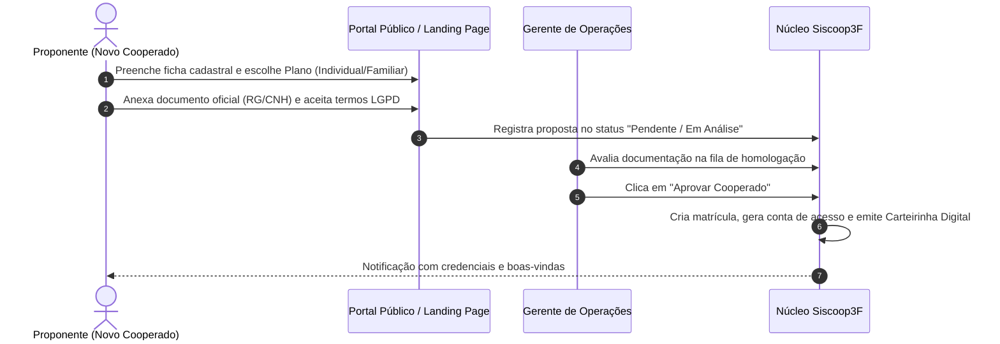
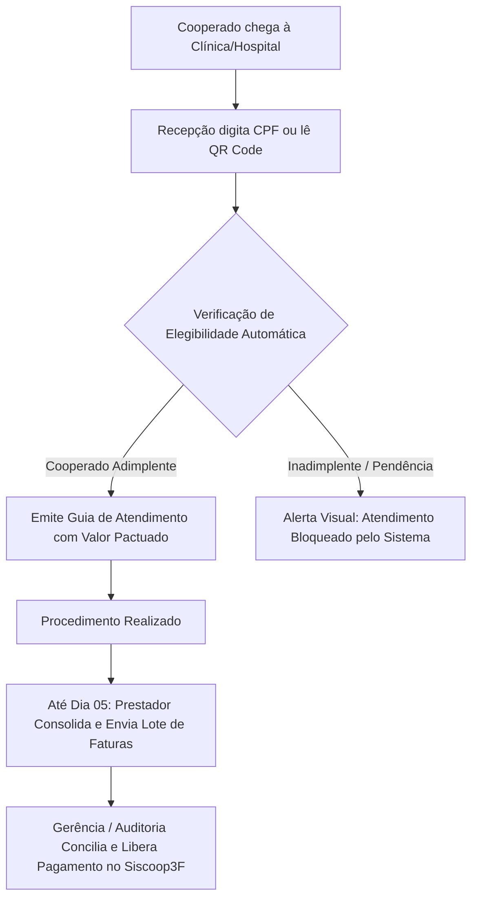
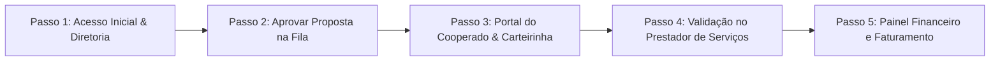

# Apresentação Executiva: Plataforma Integrada de Gestão Cooperativa de Saúde (Siscoop3F)

> **Documento Base para Geração de Slides e Demonstração Executiva**  
> **Cliente / Entidade-Alvo:** CB Saúde — Cooperativa de Saúde, Governança e Benefícios  
> **Domínio de Demonstração:** `cbsaude.siscoop3f.com.br` (Local: `cbsaude.localhost:8000`)

---

## Estrutura do Roteiro (Slide Deck Outline)

Este documento foi projetado para alimentar ferramentas de IA geradoras de apresentações (ex.: Gamma, Beautiful.ai, SlidesAI, Tome) ou subsidiar a condução presencial direta à Diretoria e Conselho da **CB Saúde**.

```
[Slide 1: Capa Executiva] ────────┐
                                  ▼
[Slide 2: Cenário e Desafios] ────┴──► [Slide 3: A Solução Siscoop3F]
                                                    │
                                                    ▼
[Slide 4: Mapa dos 4 Atores] ◄──────────────────────┘
      │
      ├─► [Slide 5: Fluxo 1 - Adesão e Ingresso Societário]
      ├─► [Slide 6: Fluxo 2 - Governança, Contas e Cota Capital]
      ├─► [Slide 7: Fluxo 3 - Jornada do Cooperado e Família]
      └─► [Slide 8: Fluxo 4 - Rede Credenciada e Regra do Dia 05]
                                                    │
                                                    ▼
[Slide 9: Painel de Indicadores] ◄──────────────────┘
      │
      ▼
[Slide 10: Roteiro Prático de Demonstração (Caminho Feliz)]
      │
      ▼
[Slide 11: Conclusão e Próximos Passos]
```

---

## Slide 1: Capa Executiva

- **Título:** Modernização Digital, Governança e Eficiência na Saúde Cooperativa
- **Subtítulo:** Apresentação da Plataforma Integrada de Operações e Benefícios da CB Saúde
- **Apresentador:** Equipe de Tecnologia & Projetos Estratégicos
- **Público:** Diretoria Executiva, Conselho de Administração e Conselho Fiscal
- **Mensagem-Chave:** *Uma única plataforma conectando cooperados, dependentes, gestores e prestadores médicos com rastreabilidade integral, transparência financeira e simplicidade operacional.*

---

## Slide 2: Cenário Atual e Desafios Operacionais

### O Desafio
As cooperativas de saúde enfrentam desafios críticos de gestão:
1. **Dispersão de Informações:** Cadastros de cooperados, fichas financeiras e guias médicas em planilhas ou sistemas desconectados.
2. **Insegurança nas Autorizações:** Dificuldade dos prestadores em verificar se um cooperado está ativo ou adimplente antes de realizar uma consulta.
3. **Morosidade no Ingresso:** Propostas de adesão físicas, com tramitação lenta de documentos e aprovações desorganizadas.
4. **Fechamento Mensal Complexo:** Faturas de médicos e clínicas chegando sem padronização, gerando glosas, atritos e atrasos no pagamento.

### O Custo da Ineficiência
- Risco financeiro por atendimentos indevidos.
- Sobrecarga operacional da equipe interna.
- Perda de visibilidade sobre a formação e evolução do patrimônio de Cota Capital.

---

## Slide 3: A Solução Siscoop3F para a CB Saúde

### Pilares Fundamentais



1. **Multitenancy com Isolamento Rigoroso:** Banco de dados e parâmetros exclusivos da CB Saúde, garantindo total conformidade com a LGPD.
2. **Ciclo Financeiro Cooperativo Automatizado:** Controle nativo de cotas de capital social, rateio de sobras, mensalidades e conciliação bancária.
3. **Acesso Democrático e Sem Barreiras:** Carteirinhas digitais com validação via QR Code, portal de autoatendimento e Link Mágico para dependentes sem necessidade de download de aplicativos pesados.
4. **Regra de Faturamento do Dia 05:** Ciclo contratual previsível para fechamento, auditoria técnica e liquidação de prestadores de serviços médicos.

---

## Slide 4: Definição dos Atores e Papéis no Sistema

Uma visão clara e didática de quem opera o sistema e quais são suas atribuições:

| Ator / Perfil | Descrição e Papel Estratégico | O Que Faz no Sistema |
| :--- | :--- | :--- |
| **1. Diretoria e Gestão Operacional** *(Presidente, Diretor Financeiro, Gerente)* | Liderança executiva responsável pelo cumprimento do estatuto, saúde financeira e controle dos fluxos da cooperativa. | Analisa indicadores em tempo real, aprova novas adesões, monitora contas bancárias e liquida faturas médicas. |
| **2. Conselho Fiscal e Auditoria** *(Presidente do Conselho Fiscal, Auditor)* | Órgão independente de fiscalização patrimonial e conformidade regulatória. | Acessa relatórios contábeis, livros fiscais, trilhas de auditoria e garante transparência aos cooperados. |
| **3. Cooperado Titular** *(Membro Associado)* | O associado que forma o patrimônio societário e usufrui da rede credenciada de benefícios. | Consulta sua Carteirinha Digital, acompanha saldo de Cota Capital, agenda serviços e gerencia seus dependentes. |
| **4. Dependente Familiar** *(Cônjuge, Filhos e Agregados)* | Beneficiário vinculado ao plano familiar do cooperado. | Acessa sua carteirinha digital individual diretamente via Link Mágico seguro pelo WhatsApp/E-mail sem senha complexa. |
| **5. Prestador Credenciado** *(Clínicas, Laboratórios e Médicos)* | Rede assistencial conveniada à cooperativa para atender os associados. | Consulta a elegibilidade em tempo real, abre guias de atendimento e envia lotes de faturamento para pagamento. |

---

## Slide 5: Fluxo 1 — Adesão e Ingresso Societário Digital

### Objetivo
Substituir processos físicos de admissão por uma jornada digital fluida, transparente e auditada.



### Destaques para a Apresentação
- Redução do tempo de admissão de semanas para poucos minutos.
- Pré-validação de CPF e prevenção contra duplicidade cadastral.
- Vinculação automática ao Plano de Adesão escolhido e programação da Cota Capital.

---

## Slide 6: Fluxo 2 — Governança Financeira e Cota Capital

### Objetivo
Demonstrar a sustentabilidade econômico-financeira da cooperativa através do controle rigoroso de caixa e patrimônio líquido.

### Principais Recursos
1. **Gestão de Contas Bancárias Integradas:**
   - Visualização consolidada de saldos em instituições cooperativas parceiras (ex.: Sicoob e Sicredi).
   - Movimentações categorizadas entre receitas operacionais, despesas administrativas e repasses médicos.
2. **Integralização da Cota Capital Social:**
   - Rastreamento individual do patrimônio integralizado por cada cooperado.
   - Histórico de parcelas, emissão de cobranças automáticas e controle de quitação.
3. **Painel do Conselho Fiscal:**
   - Relatórios pré-formatados para balancetes mensais e prestação de contas em Assembleia Geral Ordinária (AGO).

---

## Slide 7: Fluxo 3 — Experiência do Cooperado e Dependentes

### Objetivo
Oferecer conveniência moderna na palma da mão, eliminando burocracias e intermediários manuais.

### Funcionalidades Demonstradas
- **Carteirinha Digital com QR Code:**
  - Identificação visual imediata do número de matrícula, validade e tipo de plano.
  - Padrão anti-fraude: código verificável instantaneamente pela recepção do prestador.
- **Link Mágico para Dependentes:**
  - Dependentes acessam suas carteirinhas via link único e confirmação simples dos 5 primeiros dígitos do CPF.
  - Não exige memorização de login e senhas pelos familiares, tornando o uso acessível a idosos e jovens.
- **Transparência em Convênios e Tabela de Preços:**
  - Consulta direta aos parceiros conveniados (farmácias, clínicas de imagem, óticas e academias) com as porcentagens reais de desconto pactuadas.

---

## Slide 8: Fluxo 4 — Relacionamento com Prestadores e a "Regra do Dia 05"

### Objetivo
Garantir previsibilidade financeira à cooperativa e segurança no pagamento da rede assistencial.



### O Valor da "Regra do Dia 05"
- **Para a Cooperativa:** O setor financeiro recebe as faturas organizadas em data fixa, eliminando pagamentos avulsos e descontrole de fluxo de caixa.
- **Para o Prestador:** Confiança de que todos os atendimentos devidamente autorizados serão auditados e liquidados com pontualidade.

---

## Slide 9: Painel Executivo e Indicadores Estratégicos (KPIs)

Métricas gerenciais exibidas em painel interativo para subsidiar tomadas de decisão da Diretoria:

```
┌─────────────────────────┬─────────────────────────┬─────────────────────────┐
│     QUADRO SOCIAL       │      ATENDIMENTOS       │   FINANÇAS OPERACIONAIS │
│ 5 Associados Cadastrados│ 2 Agendamentos Ativos   │ Saldo Caixa Consolidado │
│ 3 Titulares Adimplentes │ 100% Guias Validadas    │ R$ 397.150,00           │
│ 2 Propostas na Fila     │ 0 Glosas Recorrentes    │ 0 Inadimplência Oculta  │
└─────────────────────────┴─────────────────────────┴─────────────────────────┘
```

1. **Taxa de Crescimento do Quadro Social:** Novos membros ingressantes versus desfiliações.
2. **Índice de Adimplência e Cota Capital:** Percentual da receita previsto vs. realizado em cada competência.
3. **Volume de Produção Médica por Especialidade:** Mapeamento das áreas com maior demanda (Clínica Geral, Cardiologia, Pediatria e Exames).

---

## Slide 10: Roteiro Prático de Demonstração (O "Caminho Feliz")

Para uma apresentação impecável de 15 a 20 minutos, siga a sequência passo a passo abaixo:



### Passo 1: Visão Geral de Governança
- **Acesso:** Faça login com `presidente@cbsaude.com.br` ou `admin@cbsaude.com.br` (senha: `senha123`).
- **O que mostrar:** O visual personalizado com a identidade da CB Saúde, saldo consolidado das contas bancárias e a síntese do quadro associativo.

### Passo 2: Homologação de Nova Adesão ao Vivo
- **Acesso:** Alternar para `gerente@cbsaude.com.br`.
- **Ação:** Navegar em **Associados > Candidatos / Propostas**.
- **O que mostrar:** Localizar a proposta da **Dra. Fernanda Lima Cavalcante**, abrir seus documentos anexos e clicar em **Aprovar**. Mostrar a geração instantânea do registro de cooperada e a emissão automática de sua carteirinha.

### Passo 3: O Ponto de Vista do Cooperado
- **Acesso:** Fazer login com `joao.associado@gmail.com` (senha: `senha123`).
- **O que mostrar:** O painel limpo do cooperado, sua **Carteirinha Digital** ativa com QR Code e a relação de seus dependentes. Demonstrar em outra aba o **Link Mágico** da dependente Ana Beatriz Silva abrindo imediatamente no celular sem senha complexa.

### Passo 4: O Teste de Validação na Clínica Credenciada
- **Acesso:** Fazer login com o prestador `sao.lucas@gmail.com` (senha: `senha123`).
- **Ação 1 (Sucesso):** Buscar a carteirinha ou CPF de João Silva (`123.456.789-09`). O sistema autoriza instantaneamente e exibe os serviços e valores acordados.
- **Ação 2 (Segurança):** Buscar o CPF de Carlos Eduardo (`852.963.741-04`). O sistema acusa pendência financeira e bloqueia a abertura indevida de guia, resguardando o caixa da cooperativa.

### Passo 5: Fechamento Financeiro e Faturas
- **Acesso:** Retornar ao painel do gerente ou diretor financeiro.
- **O que mostrar:** A lista de faturas do dia 05, status de conciliação das guias médicas e a liberação de pagamento com comprovante.

---

## Slide 11: Conclusão, Segurança e Próximos Passos

### Benefícios Diretos para a CB Saúde
- **Controle Integral:** Redução a zero de procedimentos não autorizados ou atendimentos de associados suspensos.
- **Conformidade Estatutária:** Prestação de contas estruturada para o Conselho Fiscal e auditorias externas.
- **Retenção de Cooperados:** Experiência moderna, ágil e digital para os médicos cooperados e seus dependentes.
- **Escalabilidade:** Capacidade técnica para crescer de 100 para 50.000 vidas sem necessidade de troca de sistema.

### Próximos Passos Sugeridos
1. Validação final dos parâmetros estatutários da CB Saúde.
2. Homologação das contas bancárias para geração de PIX e boletos automáticos.
3. Treinamento da equipe de atendimento e credenciamento dos prestadores prioritários.
